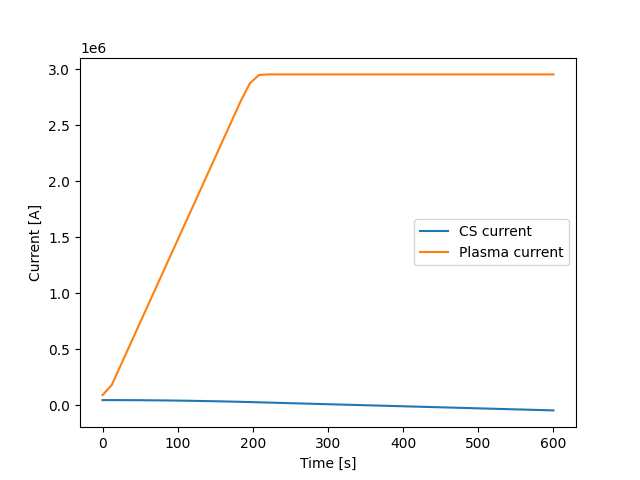

# Central solenoid induction
The first thing we need to simulate is the current induction into the plasma by the central solenoid (CS). After defining the physical constants, the characteristic quantities of the system, and making all other used quantities dimensionless and normalized with respect to these, the first step towards inducing a current into the plasma is to create a CS current profile. 

## Current Profile  
First we want to create a profile for the current that will circulate through the central solenoid, which will be the responsible for inducing a current into the plasma, as if the pair formed a transformer.  
For this purpose, the current profile of the central solenoid is commonly divided into 3 phases:  
    - Ramp-up: The current flowing through the central solenoid changes such that the induced current in the plasma increases with time.  
    - Flat-top: The change in the central solenoid's current maintains a constant induced current in the plasma.  
    - Ramp-down: The change in the current of the central solenoid is such that it brings the plasma's current back to 0.  
For our current purposes, we will only implement the ramp-up and flat-top phases. 

Before creating our profile, we first need to define the parameters that will describe it. To start, we can define the starting and ending times ${ t_{ 0 }  }$ and ${ t_{ f }  }$ through which the profile will be active. We can also define a fraction ${ r_{ t }  }$, which will be the fraction of the total time (${ t_{ f } - t_{ 0 } = t_{ f } }$, taking ${ t_{ 0 } = 0 }$ for simplicity) allocated to the ramp-up phase.  
For the current, we will have a value ${ I_{ \text{max}  }  }$, which will be the maximum current value that will flow through the central solenoid. For the profile we are aiming to construct, the current will start at ${ I_{ \text{max}  }  }$, and it will end at ${ - I_{ \text{max}  }  }$ (this means we will also be skipping the premagnetization phase, which takes the CS current from 0 to ${ I_{ \text{max}  }  }$).  

With this, we can now start creating the CS current profile. For the ramp-up phase, we want to describe the current with a function that will allow the induced current to increase with time. The easiest way in which we can do this is with a quadratic function. Then, we can write the ramp-up current profile ${ I_{ r }  }$ as:  
$$
\begin{align*}
    I_{ r } ( t ) &= - k_{ r } \left( t \right) ^{ 2 } + b_{ r } \\
    \\
    \dfrac{ d I_{ r }  }{ d t } &= - 2 k_{ r } t
\end{align*}
$$
The minus sign is added so that the induced current (which is proportional to minus the derivative of the CS current) can increase with time.  

For the flat-top phase, we want a function that will keep the induced current at a constant value. The most simple function we can use is a linear function, so we can write the flat-top profile ${ I_{ t }  }$ as:  
$$
\begin{align*}
    I_{ t } ( t ) &= -k_{ t } t + b_{ t } \\
    \\
    \dfrac{ d I_{ t }  }{ d t } &= -k_{ t } 
\end{align*}
$$
Now, we need to find values for the constants of each function. We can do this by using boundary and continuity conditions. The boundary conditions will ensure the profile starts and ends in our desired values of current, and the continuity conditions will ensure there are no jumps in either the current carried by the CS, or in the current induced into the plasma.  

Starting by the boundary conditions, if we want the profile to start with a current ${ I_{ \text{max}  }  }$, and end with a current ${ -I_{ \text{max}  }  }$, the conditions will read:  
$$
\begin{align*}
    I_{ r } ( 0 ) &=  b_{ r } \\
    &= I_{ \text{max}  } \\
    \\
    I_{ t } ( t_{ f } ) &= -k_{ t } t_{ f } + b_{ t } \\
    &= -I_{ \text{max}  }
\end{align*}
$$
From which we can immediately find that ${ b_{ r } = I_{ \text{max}  }  }$.  
For the continuity conditions, we want the profile, as well as its derivative, to be continuous at ${ t = r_{ t } t }$. This will give us:  
$$
\begin{align*}
    I_{ r } \left( r_{ t } t_{ f }  \right) &= I_{ t } \left( r_{ t } t_{ f }  \right) \\
    -k_{ r } \left( r_{ t } t_{ f }  \right) ^{ 2 } + I_{ \text{max}  } &= -k_{ t } \left( r_{ t } t_{ f }  \right) + b_{ t } \\
    \\
    \dfrac{ d I_{ r }  }{ d t } \biggr |_{ t = r_{ t } t_{ f } }^{  } &=  \dfrac{ d I_{ t }  }{ d t } \biggr |_{ t = r_{ t } t_{ f } }^{  } \\
    -2 k_{ r } \left( r_{ t } t_{ f }  \right) &= -k_{ t } 
\end{align*}
$$

Then, from these conditions we can gather 3 equations, which we can use to find the values of the 3 remaining unknowns ${ k_{ r }  }$, ${ k_{ t }  }$ and ${ b_{ t }  }$. Using whatever method we prefer to solve this system, we may eventually find the values:  
$$
\begin{align*}
    k_{ r } &= -I_{ \text{max}  } \dfrac{ 2 }{ r_{ t } t_{ f } ^{ 2 } \left( r_{ t } - 2 \right)  } \\
    \\
    k_{ t } &= -I_{ \text{max}  } \dfrac{ 4  }{ t_{ f } \left( r_{ t } - 2 \right)  } \\
    \\
    b_{ t } &= -I_{ \text{max}  } \dfrac{ r_{ t } + 2 }{ r_{ t } - 2 } 
\end{align*}
$$
Which are all function of the parameters we set at the beginning.  

One of the ways in which we can implement this to create a current profile is through a function. If we define the maximum current and total experiment time as overall system parameters (the characteristic current and time of the system), then this function only needs to take in the fraction of the time that will be dedicated towards ramp-up (`rt`), and the total number of points into which the time will be divided (`nt`):  
```python
def cs_current (rt, tn):
    # set normalized quantities
    max = 1
    tf = 1
    # lenght of time step
    ts = tf/tn
    # divide total time into rampup and flattop
    tr = tf * rt
    tt = tf - tr
    # define the rampup and flattop constants
    # rampup
    kr = (-2 * max) / (rt * tf**2 * (rt - 2))
    # flattop
    kt = (-4 * max) / (tf * (rt - 2))
    bt = max * ((-2 - rt) / (-2 + rt))
    # create array to save current profile
    curr = np.zeros(tn)
    # create time array
    t = np.linspace(0, tf, tn) 
    # go through time, assigning current values
    for i in range(len(t)):
        tc = t[i]
        # assign rampup current values
        if tc <= tr:
            curr[i] = -kr * tc**2 + max
        # assign flattop values
        else:
            curr[i] = -kt * tc + bt
    # return the current profile
    return curr
```
In the function, `max` and `tf` act as dimensionless quantities to produce the current profile, which can be then multiplied by their respective characteristic quantities to produce a meaningful result.  

For example, if we want to have an experiment which lasts a total of 10 minutes, where 1/3 of this will go towards ramp up, and where the maximum current of the central solenoid will be of 46 kA, the function will return the following profile:
 

The value of the current we induce into the plasma with a given profile will be proportional to the (negative of the) slope of the profile during flat-top operation. If we want higher induced current, meaning if we want a greater slope, we can reduce the total time of the experiment, and increase the time dedicated for ramp-up. For example, this would be the CS profile for a 6 minute long experiment, with half of that time dedicated to ramp-up (and with the same value of maximum current):
 
As can be seen, the second profile reaches a steeper slope than the first one, meaning it will induce a higher current in the plasma.  

The reason why we have to reduce the flat-top time (which is what happens when we reduce the total experiment time, or increase the ramp-up time) to increase the induced current is because we have a maximum value of current that we can carry through the central solenoid. This will in turn limit the rate at which we change this current through time, before we reach the opposite limit (${ -I_{ \text{max}  }  }$). This will be more clear when we compare the induced plasma current profile to the CS profile that induces it.  
We then have to chose whether we induce a great current into the plasma for a short time, or whether we maintain a lower current for a longer period of flat-top operation. For our current simulation, we want to focus on the current increase due to the bootstrap current in the plasma, which is more clearly seen when the CS in no longer increasing the plasma's current. We will then favor more having a longer flat-top time, than inducing a higher current in the plasma.

## Magnetic field
The next step would be to calculate the magnetic field this current profile produces in the central solenoid. Our purpose with this field is to calculate the flux that will applied on the area covered by the plasma loop, so the magnetic field only has to be calculated in the points inside this loop. This is, the field will be calculated in a 2D surface, not in 3D space.  
To find the points that make up this area, we can first start with a square mesh-grid, with side equal to the diameter of the plasma loop. We can then calculate the distance each of these points has to the center of the plasma loop, and compare it with the distance that the loop boundary would have to its center. If the point's distance is smaller than the radius of the plasma loop, this would mean that said point lies inside of the circular loop. We can do this test for every point in the square mesh-grid, and take only the points that fall inside the loop.  

After doing this for a plasma loop with a 5 m radius, we could end up with something like:
  
Where we are looking at the system from the top, and we can also see the boundaries of the central solenoid. Here, it is important that there is a similar amount of points both inside and outside of the CS, because the magnetic field it produces will go in opposite directions in either of these zones. If we want to calculate an accurate field flux, then there should not be many more points with the field pointing in one of these directions.  

For `python`, creating and manipulating mesh-grids is most easily done using `numpy`. The mesh-grids created through the `meshgrid` function give square arrays with the x and y coordinates of each point, for each location in the defined space. This organization also gives a geometric meaning to the created mesh-grid.  
However, `numpy` arrays have to have an homogeneous shape, meaning that each row has to have the same number of columns, and vice versa. When trying to take a circular slice of these arrays (the points that lie inside the plasma loop), some rows will end up with different amounts of columns. This means that we will have to store our loop points as a list of coordinates (which can still be a `numpy` array), rather than a geometric map like a mesh-grid.  

### CS definition
Once we have found the list of points inside of the loop, we can calculate the magnetic in each of them using Biot-Savart's law. For this, we first need to create the vector function that defines the central solenoid, or rather the points that make it up.  
Solenoids are basically spirals of cable, with a radius ${ r_{ cs }  }$ and a number of turns ${ n_{ cs }  }$. If placed vertically, they will also have a height ${ h_{ cs }  }$. In our case, the ${ x }$ and ${ y }$ coordinates will define the horizontal plane, while the ${ z }$ coordinate will give the vertical, height coordinate.  
For the horizontal plane, the points of the CS will just describe circles, of radius ${ r_{ cs }  }$. For the vertical component, if we place the center of the solenoid at the origin, the points will range between ${ -h_{ cs } /2 }$ and ${ h_{ cs } /2 }$. If we want a solenoid of ${ n_{ cs }  }$ loops, we need the ${ x }$ and ${ y }$ coordinates to complete ${ n_{ cs }  }$ circles in the time the ${ z }$ coordinate goes from ${ -h_{ cs } /2 }$ to ${ h_{ cs } /2 }$.  
To give the coordinates of the points, we can use cylindrical coordinates, and parametrizing using the azimuthal angle $\phi$, the desired vector ${ \vec{ l } }$ that gives the points of the CS would be given like:
$$
\begin{align*}
    \vec{ l } &= \left( \begin{matrix}
        r_{ cs } \sin \left( n_{ cs } \phi  \right) \\
        r_{ cs } \cos \left( n_{ cs } \phi  \right) \\
        \dfrac{ h_{ cs }  }{ 2 \pi } \phi  - \dfrac{ h_{ cs }  }{ 2 } 
    \end{matrix} \right) 
\end{align*}
$$
Where $\phi$ will go from ${ 0 }$ to ${ 2\pi  }$. Giving the ${ z }$ coordinate as a linear function will evenly distribute the CS loops through its entire height.  
To implement this in the code, we can once again use a function like:
```python
def cs_eq (r, h, n): 
# the eq of the coil is going to be parametrized in terms of the angle phi
# create symbol of parameter
p = sym.symbols('p')
# create the domain of the parameter (dimensionless)
# goes from 2pi to 0, meaning the current of the cs will flow clockwise
# this will make the induced plasma current to flow anti
d = np.array([0, 2 * np.pi])
# create the coordinates of the coil
x = r * sym.sin(n * p)
y = -r * sym.cos(n * p)
z = (h / (2 * np.pi)) * p - (h / 2)
# create the loop vector
l = sym.Matrix([x, y, z])
# pack everything and return
pack = [l, d, p]
return pack
```
Where we used the `sympy` library (`sym`), which allows to create an algebraic function, which will be useful further on to solve the integral that gives the magnetic field.  

We can use this function to create our central solenoid, which will have a radius of 3 m, a height of 7, and 2000 loops. If we graph a side view of it, it would look like:
  
It is important to disclaim here that the pictured solenoid only has 40 loops, as it would be difficult to properly appreciate a diagram with the 2000 loops. 

### Biot-Savart law
With the vector ${ \vec{ l } }$, now we can go ahead and use Biot-Savart's law to calculate the magnetic field the CS produces at a given point in space. For a point ${ \left( x, y, z \right) }$, we can define a vector ${ \vec{ r } }$ that goes to it from the origin, and another vector ${ \vec{ r }' }$ that goes from a point in the CS to this point ${ \left( x, y, z \right)  }$. With these, we would have all the necessary components to build the integrand, which we would have to integrate over all the central solenoid to find the total magnetic field at the point.  
Computationally, we could create a function to which we pass all the information necessary to describe the central solenoid (the argument `pack`), and the coordinates of the point at which we want to calculate the magnetic field (`xp`, `yp` and `zp`). This could be done like:
```python
def b_field (pack, xp, yp, zp):
    # unpack the coil
    # function to describe loop
    l = pack[0]
    # domanin of integration
    d = pack[1]
    # parameter symbol
    s = pack[2]
    # create the vectors for biot-savart law
    xs, ys, zs = sym.symbols('xs, ys, zs')
    # position vector
    r = sym.Matrix([xs, ys, zs])
    # vector from coil to position
    rp = r - l
    # create integrand for biot-savart
    i = sym.diff(l, s).cross(rp)/rp.norm()**3
    # separate integrand into directions, and make them a function
    dbx = sym.lambdify([s, xs, ys, zs], i[0])
    dby = sym.lambdify([s, xs, ys, zs], i[1])
    dbz = sym.lambdify([s, xs, ys, zs], i[2])
    # integrate the function of each direction at a given point
    # which gives the corresponding field component
    bx = quad(dbx, d[0], d[1], args=(xp, yp, zp))[0]
    by = quad(dby, d[0], d[1], args=(xp, yp, zp))[0]
    bz = quad(dbz, d[0], d[1], args=(xp, yp, zp))[0]
    # pack the components into a vector and return
    field = np.array([bx, by, bz])
    return field
```
In `pack`, we pass the `sympy` vector ${ \vec{ l } }$, the domain of integration, and the `sympy` symbol used for the parametrization of `l`. Then we create the symbols that make up the vector `r`, and with it we find the `sympy` version of ${ \vec{ r }' }$ (`rp`). With these three vectors, we then build the integrand `i` in the way described in Biot-Savart's law (note that the full resulting integrand would be a vector, which is the differential of the magnetic field).  
We would then need to solve the integral. This can be done by first separating the integrand `i` into its different components, and turning each of them into a separate function using `lambdify`. To actually solve the integral, we can use `scipy`'s function `quad`, which solves a quadrature for the given argument, using a given domain of integration (the same domain of the CS) and at a given point (the desired (`xp`, `yp`, `zp`)). `quad` returns a result plus an uncertainty value, of which we only grab the former (the zeroth element).  
After integrating each component of the field differential, we would be left with the three components of the magnetic field. Then, we can put them back together into a usable vector form (a `numpy` array) and then return this as the result of the function. The function `b_field` would then give us the magnetic field vector generated by the central solenoid at a given point.  

We can use our function to find the magnetic field that our central solenoid will produce. With a current of 46 kA, it will generate a field of approximately **12 T**  right at the center of the solenoid. 

## Induced EMF
Once with a function that allows to calculate the magnetic field the CS produces at any point, we can use it to calculate it at every point that lies inside the plasma loop. Then, just as these points are saved in a list, we would end up with a list of magnetic field vectors ${ \vec{ B } }$, that give the magnetic field at each point inside of the plasma loop.  
When we had previously found the points inside of the plasma loop, we had only gathered their x and y coordinates, but we had not specified their z coordinate. To calculate the magnetic field at each of these points, we need to first define their height. For this, we will assume that the plasma loop aligns perfectly with the major axis of the reactor's vessel, and that the center of the CS is placed right at the center of the vessels "doughnut" hole. This all sums up to giving the plasma loop a height of 0, so that it is aligned with the middle of the CS.  
Seen from the side, the system would look like:
 

### Field flux
Once with the magnetic fields, we can use it to calculate the flux through the plasma loop. Using the adimensional magnetic field ${ \vec{ F } }$, this would be done with the integral:
$$
\begin{align*}
    \int \vec{ F } \cdot \hat{ n }  \ \text{d} A  
\end{align*}
$$
The dot product would leave only the ${ \hat{ z } }$ component of the field, as the normal vector of the loop area is pointing in this direction. The remaining integral can be solved computationally by turning it into a summation:
$$
\begin{align*}
    \int F_{ z } \ \text{d} A  &\to \sum\limits_{ n }^{  } F_{ z } \Delta A\\
    \Delta A &= \dfrac{ A_{ cs }  }{ n_{ p }  } 
\end{align*}
$$
Where ${ n_{ p } }$ is the number of points into which we divide the space. We can then factorize the area ${ A_{ cs }  }$ to make the whole summation dimensionless.  

For our list of magnetic fields, this would translate to taking the third component of all the calculated vectors, summing them all up, and then dividing by the number of points we had. The result of this operation would be a single number, equal to the total flux the (dimensionless) magnetic field has through the area defined by the plasma loop. 

### Faraday's law
The next step would be to calculate the time derivative of the field flux, which would give the induced electromotive force into the plasma loop.  
The way the simulation is set up, the change through time is codified through the change in the CS's current. Near the beginning, we created a profile for the current that will flow through the central solenoid as time advances, so it will be this profile that we will derivate with respect to time.  
In a similar way in which we discretized the flux integral into a summation, the time derivative of the dimensionless current profile will become a division like:
$$
\begin{align*}
    \dfrac{ d I }{ d t } &\to \dfrac{ \Delta I }{ \Delta t } \\
    \Delta t &= \dfrac{ T }{ n_{ t } } 
\end{align*}
$$
Where ${ T }$ is the total time of the simulation, and ${ n_{ t } }$ is the number of steps into which this total time is divided. ${ \Delta I }$ would be the difference in the current from one moment in time to the other.  

For our python code, we can easily find ${ \Delta I }$ using `numpy`'s `gradient`. This function gives us the difference from one array element to the other, in a way in which the resulting array has the same length as the original one. Then, we just multiply this result by `nt` (the number of time steps), and we would have the dimensionless time derivative of the current profile, which in turn gives the time derivative component for the magnetic field flux. 

## Induced current
With the dimensionless field flux and the time derivative of the current profile, we can find the dimensionless EMF as the product of these two quantities. Given that the time derivative gives another array, the EMF will also be an array, which represents the EMF that is induced by the CS into the plasma at the different moments of the simulation.  
With this, the only thing we are missing to find the current that is induced into the plasma is the resistance of the plasma.

### Current density
First, it will be useful to find the current density that is induced into the plasma. Formally, this current density can be found with the total induced current, dividing it over the cross sectional area of the plasma, and pointing it in the same direction as the current flows.  
However, working with dimensionless quantities, the current density will simply be equal to the dimensionless EMF. 

### Plasma resistance
To find the total resistance of the plasma, we first need to find the plasma resistivity, then multiply it by the length of the plasma loop, and divide it over its cross sectional area.  
The plasma resistivity can be found using the formula for the Spitzer resistivity, which will be a function of parameters of the system. For the current simulation, none of this parameters (temperature and particle density, which combine to give the Coulomb logarithm) will change, so the resistivity can be calculated once at the beginning of the program.  
The same thing goes for the length and area of the plasma. Then, the plasma resistance can be treated (and defined) as another system parameter. 

### CS-induced plasma current 
After all these calculations are made, we can finally find the current that is induced into the plasma by the central solenoid. With the dimensionless EMF, we just have to multiply by the corresponding dimension factor, and divide it over the plasma resistance to find the respective current.  
For the system we have been describing thus far, the current that would be induced into the plasma would look like:
  
As can be seen, the current in the plasma increases linearly up to a certain value, in this case of around 3 MA, and then remains constant. This is what is meant by the names "ramp-up" and "flat-top".  
Another thing that can be notices is that the central solenoid current profile is plotted as well, although it looks quite flat compared to the plasma current. This is the exact purpose of the central solenoid, and the reason why it may be heard that tokamak reactors are essentially electric transformers. A (relatively) small current flowing through the various loops of the central solenoid induces a much greater current in the single loop of plasma. 
